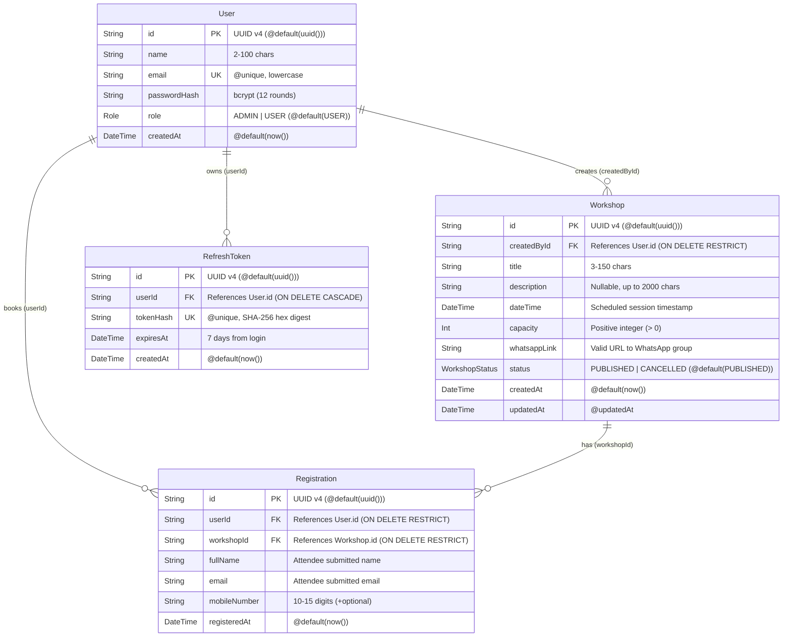

# WORKSHOP — Database Design

The PostgreSQL database is managed via Prisma (`server/prisma/schema.prisma`) and consists of **4 models** and **2 enums**.

---

## Entity-Relationship Diagram

---

## Database Constraints & Business Rules

1. **Unique Email Constraint (`User_email_key`)**: Enforces one account per normalized (trimmed, lowercase) email address.
2. **Composite Unique Registration Constraint (`@@unique([userId, workshopId])`)**: Guarantees at the database level that a user can never book the same workshop twice, acting as a hard safety net behind the application-level check.
3. **Referential Integrity (`ON DELETE RESTRICT` vs `ON DELETE CASCADE`)**:
   - `Workshop.createdById`, `Registration.userId`, and `Registration.workshopId` use `ON DELETE RESTRICT` to prevent accidental deletion of users or workshops that have historical registration records.
   - `RefreshToken.userId` uses `ON DELETE CASCADE` so deleting a user automatically purges all of their active sessions.
4. **Pessimistic Concurrency Control**: Capacity-sensitive mutations (`registerForWorkshop`, `updateWorkshop`, `cancelWorkshop`, `publishWorkshop`) acquire a PostgreSQL row lock (`SELECT "id" FROM "Workshop" WHERE "id" = $1 FOR UPDATE`) before reading registration counts or mutating status.
