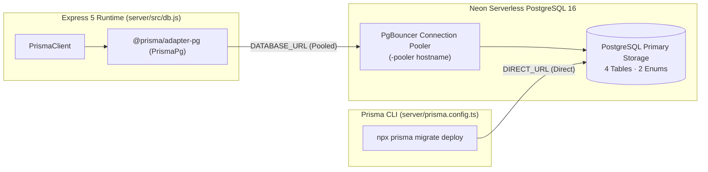
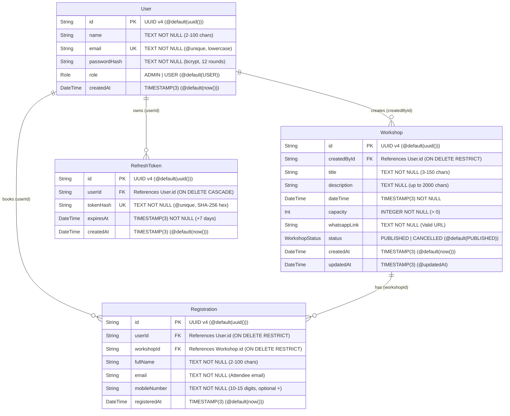
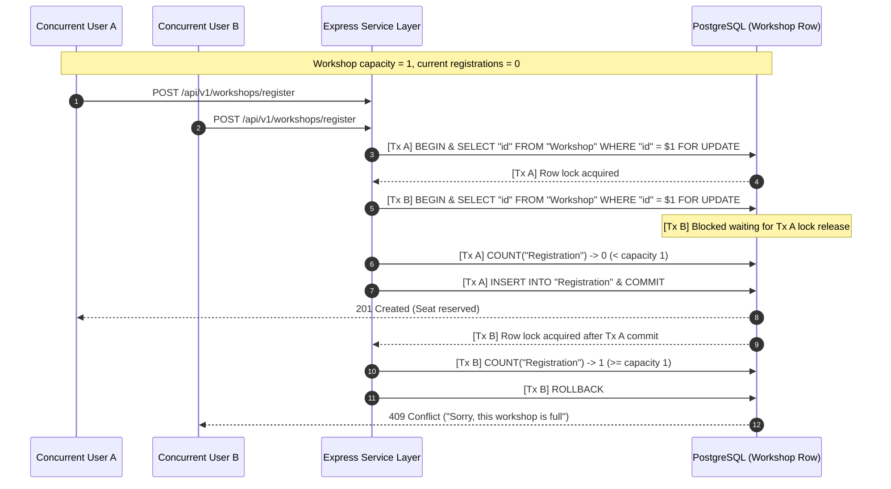

# WORKSHOP — Database Design & Architecture

This document provides the complete database architecture, relational schema specification, referential integrity rules, concurrency locking mechanisms, and query patterns for **WORKSHOP — Workshop Management & Discovery Platform**.

---

## Table of Contents

1. [Database Engine & Connection Architecture](#1-database-engine--connection-architecture)
2. [Entity-Relationship Diagram (ERD)](#2-entity-relationship-diagram-erd)
3. [Enumerated Types](#3-enumerated-types)
4. [Detailed Table Specifications](#4-detailed-table-specifications)
5. [Relationships & Referential Integrity](#5-relationships--referential-integrity)
6. [Indexes & Uniqueness Constraints](#6-indexes--uniqueness-constraints)
7. [Concurrency Control & Pessimistic Locking](#7-concurrency-control--pessimistic-locking)
8. [Core Query Patterns & Derived Fields](#8-core-query-patterns--derived-fields)
9. [Migrations & Admin Seeding](#9-migrations--admin-seeding)
10. [Prisma Schema & SQL DDL Reference](#10-prisma-schema--sql-ddl-reference)

---

## 1. Database Engine & Connection Architecture

| Component | Technology | Role in Architecture |
| :--- | :--- | :--- |
| **Database Engine** | **PostgreSQL 16** (Hosted on **Neon Serverless**) | Primary relational data store providing ACID transactions, row-level locking (`FOR UPDATE`), and strict foreign-key enforcement. |
| **ORM Layer** | **Prisma ORM (`^7.10.1`)** | Type-safe query builder, interactive transaction manager (`prisma.$transaction`), and schema migration engine. |
| **Driver Adapter** | **`@prisma/adapter-pg` + `pg` (`^8.23.1`)** | Prisma 7 driver adapter (`server/src/db.js`) connecting `PrismaClient` over node-postgres connection pools. |
| **Runtime Connection (`DATABASE_URL`)** | **Neon PgBouncer Pooled Endpoint (`-pooler`)** | Used by the Express serverless runtime (`server/src/db.js`) to multiplex high-concurrency serverless connections safely. |
| **Migration Connection (`DIRECT_URL`)** | **Neon Direct Endpoint (Non-Pooled)** | Configured in `server/prisma.config.ts` exclusively for `prisma migrate` CLI operations that require PostgreSQL advisory locks. |



---

## 2. Entity-Relationship Diagram (ERD)

The schema consists of **4 relational tables** (`User`, `Workshop`, `Registration`, `RefreshToken`) and **2 native PostgreSQL enums** (`Role`, `WorkshopStatus`).



---

## 3. Enumerated Types

### 3.1 `Role`
Defines account-level authorization across the participant and administration portals.

| Enum Value | Default? | Portal Access | Description |
| :--- | :---: | :--- | :--- |
| `USER` | Yes | Participant Portal (`/workshops`, `/my-workshops`, `/profile`) | Standard learner account created via `POST /api/v1/auth/register`. |
| `ADMIN` | No | Admin Portal (`/admin/workshops`, `/admin/workshops/:id/registrations`) | Privileged organizer account provisioned via the idempotent `server/prisma/seed.js` script. |

### 3.2 `WorkshopStatus`
Controls workshop visibility and booking eligibility without destructive row deletion.

| Enum Value | Default? | Publicly Visible? | Bookable? | Description |
| :--- | :---: | :---: | :---: | :--- |
| `PUBLISHED` | Yes | Yes (if `dateTime >= NOW()`) | Yes (if seats available) | Active workshop open for discovery and participant registration. |
| `CANCELLED` | No | Hidden from public catalog | No | Soft-cancelled by an administrator; remains visible in participants' **My Workshops → Cancelled** tab and the admin dashboard. |

---

## 4. Detailed Table Specifications

### 4.1 `User` Table
Stores both regular participants (`USER`) and platform administrators (`ADMIN`) in a unified identity table.

| Column | Prisma Type | PostgreSQL Type | Nullable | Default | Constraints & Validation Rules |
| :--- | :--- | :--- | :---: | :--- | :--- |
| `id` | `String` | `TEXT` | `NOT NULL` | `uuid()` | **Primary Key (`User_pkey`)**. UUID v4 generated by Prisma. |
| `name` | `String` | `TEXT` | `NOT NULL` | — | Trimmed string (`2–100` characters via Zod). |
| `email` | `String` | `TEXT` | `NOT NULL` | — | **Unique (`User_email_key`)**. Normalized to lowercase and trimmed before queries/writes. |
| `passwordHash` | `String` | `TEXT` | `NOT NULL` | — | `bcrypt` hash generated with `12` salt rounds. Never selected or returned in API responses. |
| `role` | `Role` | `"Role"` | `NOT NULL` | `'USER'` | Either `'USER'` or `'ADMIN'`. Checked by `authenticateUser` and `authenticateAdmin` middlewares. |
| `createdAt` | `DateTime` | `TIMESTAMP(3)` | `NOT NULL` | `CURRENT_TIMESTAMP` | Account creation timestamp in UTC. |

### 4.2 `Workshop` Table
Stores workshop metadata, scheduling, seat capacity, and the cohort's WhatsApp group invite link.

| Column | Prisma Type | PostgreSQL Type | Nullable | Default | Constraints & Validation Rules |
| :--- | :--- | :--- | :---: | :--- | :--- |
| `id` | `String` | `TEXT` | `NOT NULL` | `uuid()` | **Primary Key (`Workshop_pkey`)**. UUID v4. |
| `createdById` | `String` | `TEXT` | `NOT NULL` | — | **Foreign Key (`Workshop_createdById_fkey`)** → `User(id)`. Identifies the admin who created the session. |
| `title` | `String` | `TEXT` | `NOT NULL` | — | Trimmed string (`3–150` characters). Indexed in memory for case-insensitive search. |
| `description` | `String?` | `TEXT` | `NULL` | `NULL` | Optional session overview (up to `2000` characters). |
| `dateTime` | `DateTime` | `TIMESTAMP(3)` | `NOT NULL` | — | Scheduled start timestamp (must be in the future on creation and republication). |
| `capacity` | `Int` | `INTEGER` | `NOT NULL` | — | Positive integer (`>= 1`). Cannot be reduced below active registration count on update. |
| `whatsappLink` | `String` | `TEXT` | `NOT NULL` | — | Valid URL (`https://chat.whatsapp.com/...`). Omitted from public listing queries; exposed only after registration or to admins. |
| `status` | `WorkshopStatus` | `"WorkshopStatus"` | `NOT NULL` | `'PUBLISHED'` | `'PUBLISHED'` or `'CANCELLED'`. |
| `createdAt` | `DateTime` | `TIMESTAMP(3)` | `NOT NULL` | `CURRENT_TIMESTAMP` | Creation timestamp. |
| `updatedAt` | `DateTime` | `TIMESTAMP(3)` | `NOT NULL` | `@updatedAt` | Automatically updated by Prisma on every record modification. |

### 4.3 `Registration` Table
Links an authenticated `User` to a `Workshop` and snapshots the attendee's contact details submitted at booking time.

| Column | Prisma Type | PostgreSQL Type | Nullable | Default | Constraints & Validation Rules |
| :--- | :--- | :--- | :---: | :--- | :--- |
| `id` | `String` | `TEXT` | `NOT NULL` | `uuid()` | **Primary Key (`Registration_pkey`)**. Displayed to users as their Registration ID. |
| `userId` | `String` | `TEXT` | `NOT NULL` | — | **Foreign Key (`Registration_userId_fkey`)** → `User(id)`. |
| `workshopId` | `String` | `TEXT` | `NOT NULL` | — | **Foreign Key (`Registration_workshopId_fkey`)** → `Workshop(id)`. |
| `fullName` | `String` | `TEXT` | `NOT NULL` | — | Attendee's full name submitted on the booking form (`2–100` chars). |
| `email` | `String` | `TEXT` | `NOT NULL` | — | Attendee's normalized email address where Resend dispatches confirmation. |
| `mobileNumber` | `String` | `TEXT` | `NOT NULL` | — | Attendee's phone number matching `/^\+?[0-9]{10,15}$/`. |
| `registeredAt` | `DateTime` | `TIMESTAMP(3)` | `NOT NULL` | `CURRENT_TIMESTAMP` | Exact booking timestamp used for chronological sorting. |

> [!NOTE]
> **Why Contact Details Are Stored on `Registration`**: Storing `fullName`, `email`, and `mobileNumber` directly on the `Registration` row (in addition to `User.name` and `User.email`) preserves an immutable historical audit trail of the exact attendee contact details submitted for each specific workshop.

### 4.4 `RefreshToken` Table
Backs the dual-cookie stateful session architecture (`sessionToken` for users and `adminSessionToken` for administrators).

| Column | Prisma Type | PostgreSQL Type | Nullable | Default | Constraints & Validation Rules |
| :--- | :--- | :--- | :---: | :--- | :--- |
| `id` | `String` | `TEXT` | `NOT NULL` | `uuid()` | **Primary Key (`RefreshToken_pkey`)**. |
| `userId` | `String` | `TEXT` | `NOT NULL` | — | **Foreign Key (`RefreshToken_userId_fkey`)** → `User(id)`. |
| `tokenHash` | `String` | `TEXT` | `NOT NULL` | — | **Unique (`RefreshToken_tokenHash_key`)**. 64-character hex SHA-256 digest of the raw 32-byte session token. |
| `expiresAt` | `DateTime` | `TIMESTAMP(3)` | `NOT NULL` | — | Set to `NOW() + 7 days` (`SESSION_DURATION_DAYS = 7`). |
| `createdAt` | `DateTime` | `TIMESTAMP(3)` | `NOT NULL` | `CURRENT_TIMESTAMP` | Session issuance timestamp. |

---

## 5. Relationships & Referential Integrity

All foreign keys are enforced at the PostgreSQL engine level:

| Constraint Name | Source Table.Column | Target Table.Column | Cardinality | `ON DELETE` | `ON UPDATE` | Architectural Rationale |
| :--- | :--- | :--- | :---: | :---: | :---: | :--- |
| `Workshop_createdById_fkey` | `Workshop.createdById` | `User.id` | `N:1` | `RESTRICT` | `CASCADE` | Prevents deleting an administrator account that owns published or historical workshops. |
| `Registration_userId_fkey` | `Registration.userId` | `User.id` | `N:1` | `RESTRICT` | `CASCADE` | Protects workshop attendance records and seat counts from accidental user deletion. |
| `Registration_workshopId_fkey` | `Registration.workshopId` | `Workshop.id` | `N:1` | `RESTRICT` | `CASCADE` | Prevents hard-deleting a workshop that has registered participants (workshops use soft cancellation via `status = 'CANCELLED'`). |
| `RefreshToken_userId_fkey` | `RefreshToken.userId` | `User.id` | `N:1` | `CASCADE` | `CASCADE` | Automatically purges all active authentication sessions if a user record is removed. |

---

## 6. Indexes & Uniqueness Constraints

| Index Name | Table | Column(s) | Type | Purpose |
| :--- | :--- | :--- | :--- | :--- |
| `User_pkey` | `User` | `("id")` | `PRIMARY KEY` (B-Tree) | Fast `O(log n)` user lookup by UUID during session validation. |
| `User_email_key` | `User` | `("email")` | `UNIQUE INDEX` (B-Tree) | Enforces one account per email and accelerates login lookups (`findUnique({ where: { email } })`). |
| `Workshop_pkey` | `Workshop` | `("id")` | `PRIMARY KEY` (B-Tree) | Fast lookup and row locking (`WHERE "id" = $1 FOR UPDATE`). |
| `Registration_pkey` | `Registration` | `("id")` | `PRIMARY KEY` (B-Tree) | Unique identifier for each booking confirmation. |
| `Registration_userId_workshopId_key` | `Registration` | `("userId", "workshopId")` | `UNIQUE INDEX` (Composite B-Tree) | Hard database guarantee preventing duplicate bookings by the same user for the same workshop (caught via Prisma error code `P2002`). |
| `RefreshToken_pkey` | `RefreshToken` | `("id")` | `PRIMARY KEY` (B-Tree) | Primary key for session token rows. |
| `RefreshToken_tokenHash_key` | `RefreshToken` | `("tokenHash")` | `UNIQUE INDEX` (B-Tree) | Enables constant-time session verification on every authenticated API request (`findUnique({ where: { tokenHash } })`). |

---

## 7. Concurrency Control & Pessimistic Locking

To prevent race conditions (such as two users simultaneously booking the last remaining seat of a workshop, or an admin reducing capacity while a booking is in flight), all capacity- and status-sensitive mutations execute inside an interactive transaction (`prisma.$transaction`) that acquires a **PostgreSQL row-level exclusive lock** (`SELECT ... FOR UPDATE`) on the target `Workshop` row.



### Operations Protected by `SELECT ... FOR UPDATE`

| Service Function | File | Invariants Verified Under Row Lock |
| :--- | :--- | :--- |
| `registerForWorkshop` | `server/src/services/registration.service.js` | 1. Workshop exists<br/>2. `status === "PUBLISHED"`<br/>3. `dateTime > NOW()`<br/>4. No existing `(userId, workshopId)` row<br/>5. `registrationCount < capacity` |
| `updateWorkshop` | `server/src/services/workshop.service.js` | 1. Workshop exists<br/>2. If `capacity` is modified, `newCapacity >= _count.registrations` |
| `cancelWorkshop` | `server/src/services/workshop.service.js` | 1. Workshop exists<br/>2. `status !== "CANCELLED"` before setting `status = "CANCELLED"` |
| `publishWorkshop` | `server/src/services/workshop.service.js` | 1. Workshop exists<br/>2. `status !== "PUBLISHED"`<br/>3. `dateTime > NOW()` before setting `status = "PUBLISHED"` |

---

## 8. Core Query Patterns & Derived Fields

### 8.1 Real-Time Seat Calculation (Zero Redundant Counter Columns)
Rather than storing a mutable `registeredCount` integer column on `Workshop` (which can drift out of sync), the database computes seat utilization dynamically using Prisma relation aggregation (`_count: { select: { registrations: true } }`):
- `registrationCount = workshop._count.registrations`
- `availableSeats = Math.max(workshop.capacity - registrationCount, 0)`

### 8.2 Context-Aware Discovery Filtering
When fetching published workshops (`getPublishedWorkshops` in `server/src/services/workshop.service.js`), the query dynamically adapts based on whether the requester has a valid `sessionToken`:
- **Base filter**: `status: "PUBLISHED"` and `dateTime: { gte: new Date() }`.
- **Authenticated user exclusion**: Appends `registrations: { none: { userId } }` (`NOT EXISTS`), automatically hiding workshops the logged-in user has already booked.
- **Keyword search**: Case-insensitive `ILIKE` (`mode: "insensitive"`) across `title` and `description`.

### 8.3 Admin Participant Directory Search
In `server/src/services/admin-registration.service.js`, administrators can search registrations either globally or per workshop using case-insensitive `OR` filters across:
- `fullName: { contains: search, mode: "insensitive" }`
- `email: { contains: search, mode: "insensitive" }`
- `mobileNumber: { contains: search, mode: "insensitive" }`

---

## 9. Migrations & Admin Seeding

### Applying Migrations in Production
Schema migrations are tracked in `server/prisma/migrations/` and executed via the non-pooled `DIRECT_URL`:
```bash
cd server
npx prisma migrate deploy
```

### Idempotent Administrator Provisioning (`server/prisma/seed.js`)
The seed script reads `ADMIN_NAME`, `ADMIN_EMAIL`, and `ADMIN_PASSWORD` (enforcing a minimum length of 12 characters), hashes the password with `bcrypt` (`12` rounds), and executes an atomic `prisma.user.upsert` keyed on the normalized email address:
```bash
cd server
npm run db:seed-admin
```
Running the seed script multiple times safely updates the existing admin account's credentials and ensures `role = "ADMIN"` without creating duplicate rows.

---

## 10. Prisma Schema & SQL DDL Reference

<details>
<summary><strong>Click to view complete Prisma Schema (<code>server/prisma/schema.prisma</code>)</strong></summary>

```prisma
generator client {
  provider = "prisma-client-js"
}

datasource db {
  provider = "postgresql"
}

enum Role {
  ADMIN
  USER
}

model User {
  id            String         @id @default(uuid())
  name          String
  email         String         @unique
  passwordHash  String
  role          Role           @default(USER)
  createdAt     DateTime       @default(now())
  workshops     Workshop[]
  registrations Registration[]
  refreshTokens RefreshToken[]
}

enum WorkshopStatus {
  PUBLISHED
  CANCELLED
}

model Workshop {
  id           String         @id @default(uuid())
  createdById  String
  title        String
  description  String?
  dateTime     DateTime
  capacity     Int
  whatsappLink String
  status       WorkshopStatus @default(PUBLISHED)
  createdAt    DateTime       @default(now())
  updatedAt    DateTime       @updatedAt

  createdBy     User           @relation(fields: [createdById], references: [id])
  registrations Registration[]
}

model Registration {
  id           String   @id @default(uuid())
  userId       String
  workshopId   String
  fullName     String
  email        String
  mobileNumber String
  registeredAt DateTime @default(now())

  user     User     @relation(fields: [userId], references: [id])
  workshop Workshop @relation(fields: [workshopId], references: [id])

  @@unique([userId, workshopId])
}

model RefreshToken {
  id        String   @id @default(uuid())
  userId    String
  tokenHash String   @unique
  expiresAt DateTime
  createdAt DateTime @default(now())

  user User @relation(fields: [userId], references: [id], onDelete: Cascade)
}
```

</details>

<details>
<summary><strong>Click to view generated PostgreSQL DDL (<code>20261111092047_init/migration.sql</code>)</strong></summary>

```sql
-- CreateEnum
CREATE TYPE "Role" AS ENUM ('ADMIN', 'USER');

-- CreateEnum
CREATE TYPE "WorkshopStatus" AS ENUM ('PUBLISHED', 'CANCELLED');

-- CreateTable
CREATE TABLE "User" (
    "id" TEXT NOT NULL,
    "name" TEXT NOT NULL,
    "email" TEXT NOT NULL,
    "passwordHash" TEXT NOT NULL,
    "role" "Role" NOT NULL DEFAULT 'USER',
    "createdAt" TIMESTAMP(3) NOT NULL DEFAULT CURRENT_TIMESTAMP,

    CONSTRAINT "User_pkey" PRIMARY KEY ("id")
);

-- CreateTable
CREATE TABLE "Workshop" (
    "id" TEXT NOT NULL,
    "createdById" TEXT NOT NULL,
    "title" TEXT NOT NULL,
    "description" TEXT,
    "dateTime" TIMESTAMP(3) NOT NULL,
    "capacity" INTEGER NOT NULL,
    "whatsappLink" TEXT NOT NULL,
    "status" "WorkshopStatus" NOT NULL DEFAULT 'PUBLISHED',
    "createdAt" TIMESTAMP(3) NOT NULL DEFAULT CURRENT_TIMESTAMP,
    "updatedAt" TIMESTAMP(3) NOT NULL,

    CONSTRAINT "Workshop_pkey" PRIMARY KEY ("id")
);

-- CreateTable
CREATE TABLE "Registration" (
    "id" TEXT NOT NULL,
    "userId" TEXT NOT NULL,
    "workshopId" TEXT NOT NULL,
    "fullName" TEXT NOT NULL,
    "email" TEXT NOT NULL,
    "mobileNumber" TEXT NOT NULL,
    "registeredAt" TIMESTAMP(3) NOT NULL DEFAULT CURRENT_TIMESTAMP,

    CONSTRAINT "Registration_pkey" PRIMARY KEY ("id")
);

-- CreateTable
CREATE TABLE "RefreshToken" (
    "id" TEXT NOT NULL,
    "userId" TEXT NOT NULL,
    "tokenHash" TEXT NOT NULL,
    "expiresAt" TIMESTAMP(3) NOT NULL,
    "createdAt" TIMESTAMP(3) NOT NULL DEFAULT CURRENT_TIMESTAMP,

    CONSTRAINT "RefreshToken_pkey" PRIMARY KEY ("id")
);

-- CreateIndex
CREATE UNIQUE INDEX "User_email_key" ON "User"("email");

-- CreateIndex
CREATE UNIQUE INDEX "Registration_userId_workshopId_key" ON "Registration"("userId", "workshopId");

-- CreateIndex
CREATE UNIQUE INDEX "RefreshToken_tokenHash_key" ON "RefreshToken"("tokenHash");

-- AddForeignKey
ALTER TABLE "Workshop" ADD CONSTRAINT "Workshop_createdById_fkey" FOREIGN KEY ("createdById") REFERENCES "User"("id") ON DELETE RESTRICT ON UPDATE CASCADE;

-- AddForeignKey
ALTER TABLE "Registration" ADD CONSTRAINT "Registration_userId_fkey" FOREIGN KEY ("userId") REFERENCES "User"("id") ON DELETE RESTRICT ON UPDATE CASCADE;

-- AddForeignKey
ALTER TABLE "Registration" ADD CONSTRAINT "Registration_workshopId_fkey" FOREIGN KEY ("workshopId") REFERENCES "Workshop"("id") ON DELETE RESTRICT ON UPDATE CASCADE;

-- AddForeignKey
ALTER TABLE "RefreshToken" ADD CONSTRAINT "RefreshToken_userId_fkey" FOREIGN KEY ("userId") REFERENCES "User"("id") ON DELETE CASCADE ON UPDATE CASCADE;
```

</details>
