# WORKSHOP — User Experience Walkthrough

A visual tour of the **WORKSHOP** platform across both the administrator portal and the participant experience.

---

# 1. ADMIN EXPERIENCE

### 1. Admin Login

The administrator can securely sign in to access the workshop management portal.

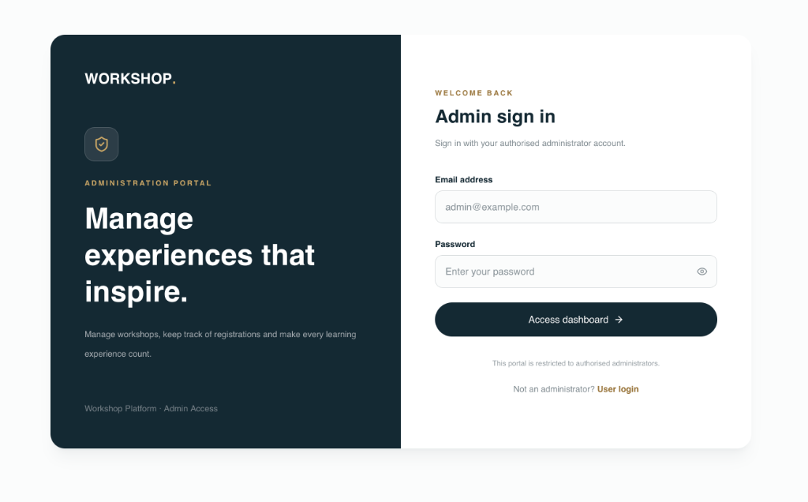

### 2. Admin Dashboard & Workshop Management

The central control panel displays platform metrics alongside controls to search, filter, sort, edit, or cancel published workshops.

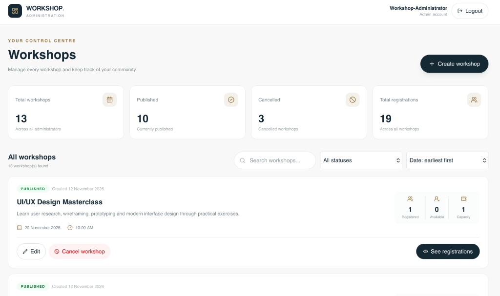

### 3. Create Workshop

Administrators can publish a new workshop by specifying its title, description, scheduled date and time, seat capacity, and WhatsApp group link.

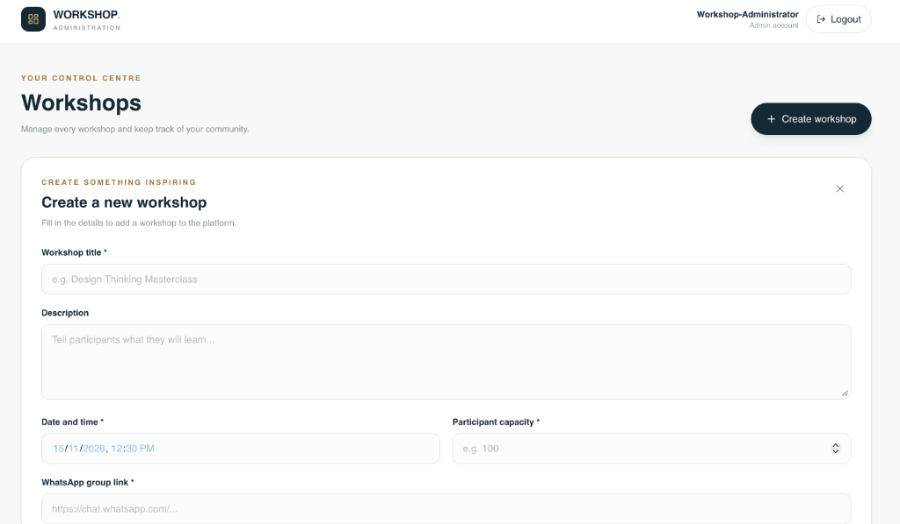

### 4. Edit Workshop

Existing workshop details, schedules, participant capacity, and communication links can be updated at any time.

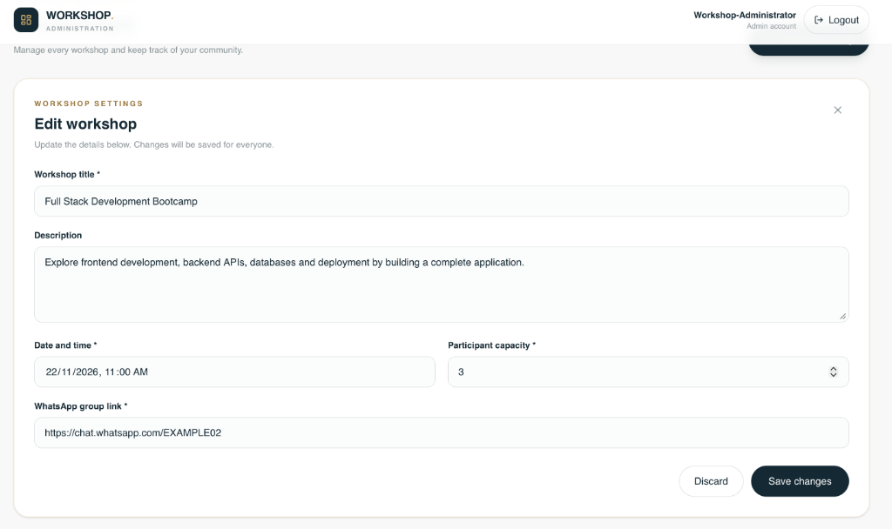

### 5. Workshop Registrations & Participant Directory

Administrators can monitor seat utilization for a specific workshop and search registered participants by name, email address, or mobile number.

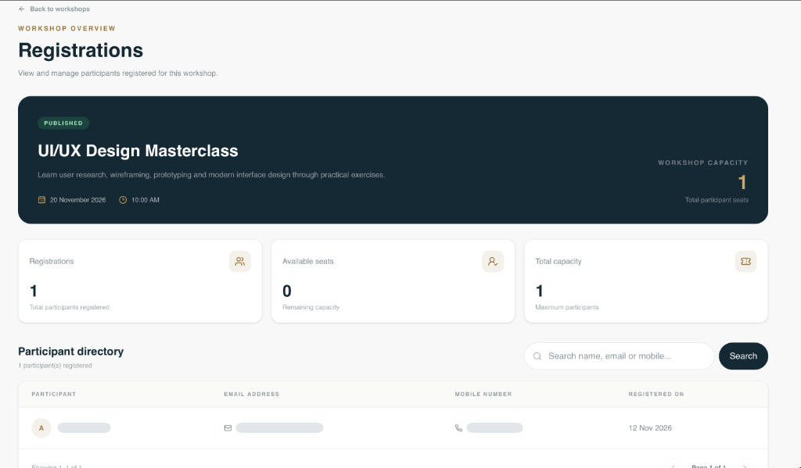

---

# 2. USER / CLIENT EXPERIENCE

### 1. Login & Authentication

Participants can sign in to their account to register for upcoming sessions and manage their learning journey.

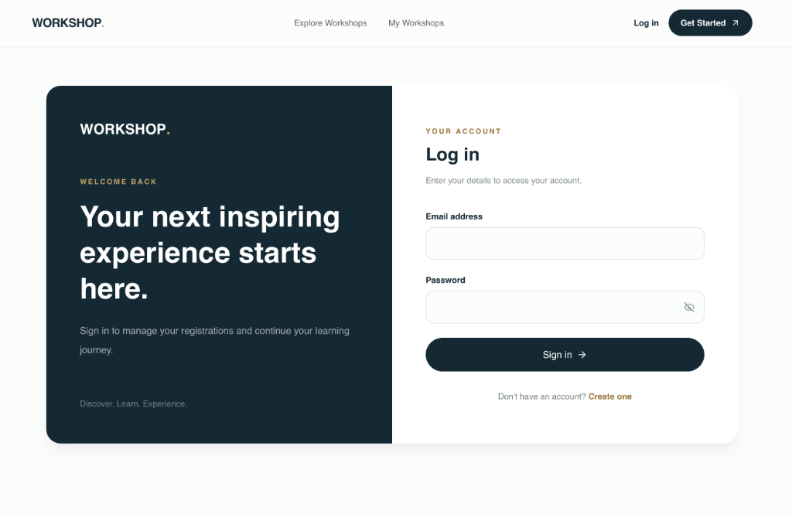

### 2. Explore Workshops

The landing page introduces the curated workshop collection with quick navigation to personal registrations.

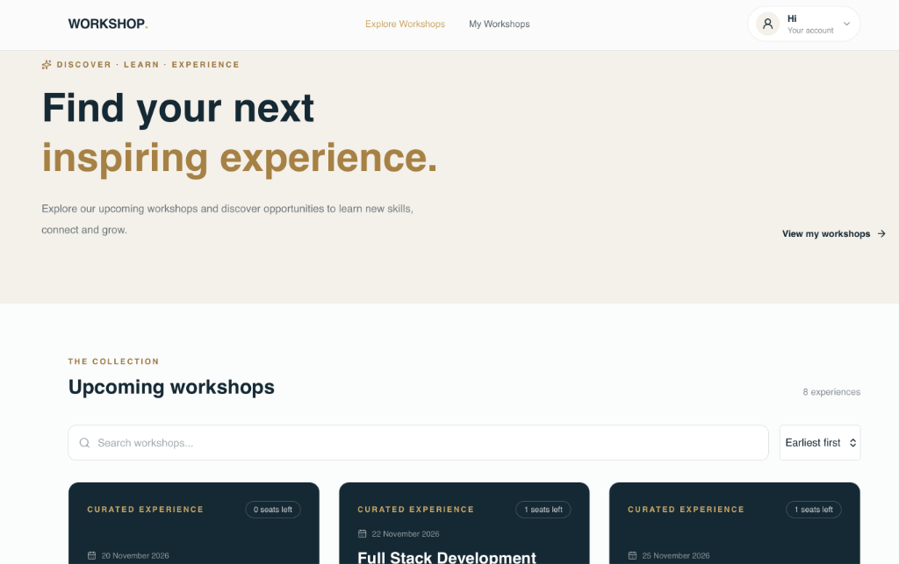

### 3. Workshop Discovery & Sorting

Users can search upcoming workshops by keyword, sort sessions by date, and check real-time seat availability before registering.

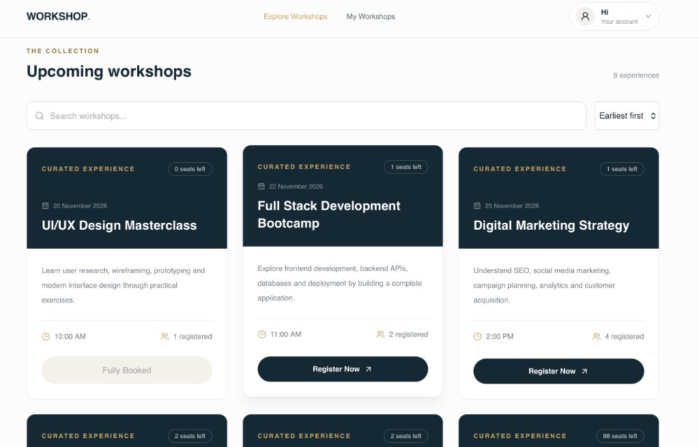

### 4. Workshop Registration

Participants can review the selected workshop's schedule and submit their contact details to reserve a seat.

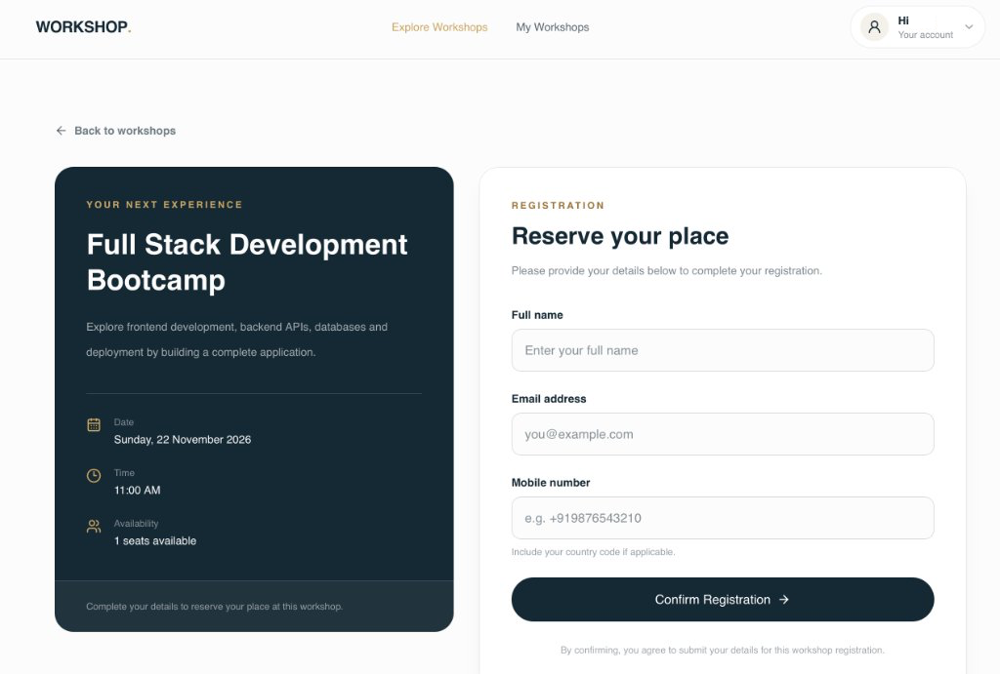

### 5. Join WhatsApp Group

Upon completing registration, participants receive instant confirmation and a direct link to join the workshop's official WhatsApp group.

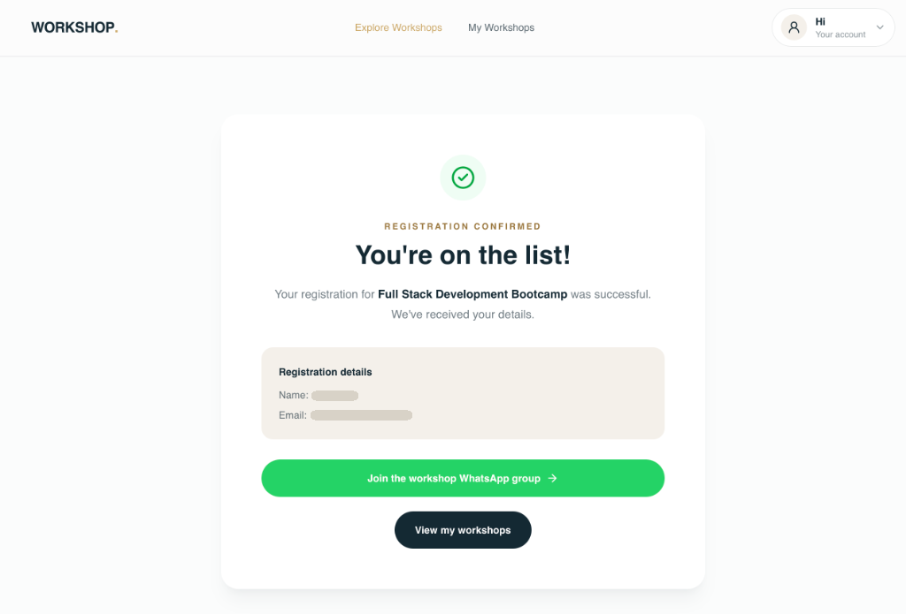

### 6. My Workshops & Registration Status

Participants can view all of their registered workshops, filter by upcoming, past, or cancelled status, and access each session's WhatsApp group.

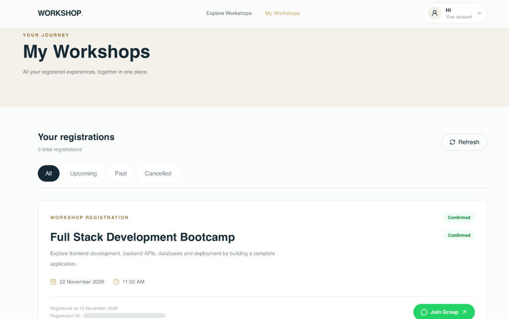

### 7. Account & Profile

The profile page summarizes the participant's workshop journey and allows them to view or update their personal account information.

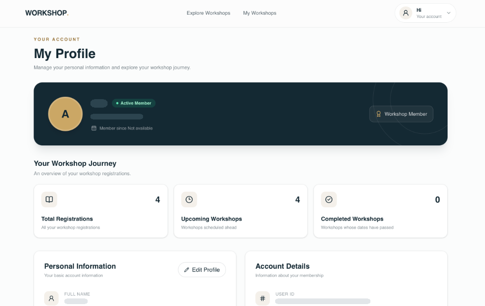
